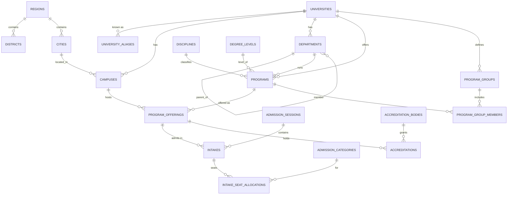
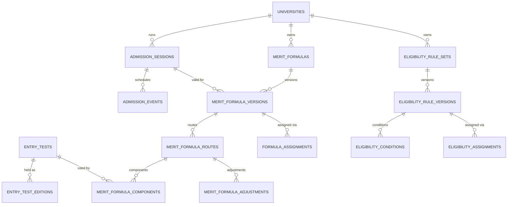
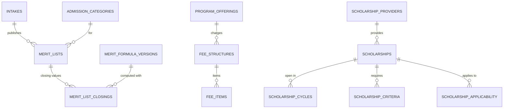
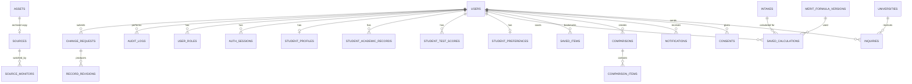

# Sccuni — Database Design

- **Status:** DRAFT v0.1. Logical design for approval. The physical Prisma schema is written in Phase 3/6 after approval.
- **Last updated:** 19 Nov 2026.
- **DBMS:** PostgreSQL 16+.
- **Extensions:** `pg_trgm`, `unaccent`, `citext`; `vector` (pgvector) in Release 2.
- **Related:** [SYSTEM_ARCHITECTURE.md](./SYSTEM_ARCHITECTURE.md) §5 · [Official-source evidence](./research/OFFICIAL_SOURCES_RESEARCH.md)

---

## 1. Design principles

1. **Normalised core, denormalised read models.** 3NF for the source of truth. The search table and caches are derived and rebuildable.
2. **The academic session is a first-class dimension.** Formulas, eligibility, seats, fees, deadlines and merits are always tied to a session or academic year. Nothing is "current" implicitly.
3. **History is immutable.** Verified formula and rule versions are frozen. Saved calculations are snapshots. Edits go through change requests and leave revisions.
4. **Different kinds of measurement are never mixed.** A closing aggregate, a closing position and a test score are different metrics with different columns and checks.
5. **Provenance on every critical row.** Each one carries a source, a locator, verification status, verifier and dates.
6. **Exact numbers.** `NUMERIC` for marks, weights, aggregates and money. Never floating point.
7. **No personal data from merit lists.** Only closing values are stored, never names, CNICs or roll numbers.

## 2. Conventions

| Concern | Convention |
|---|---|
| Primary keys | `id UUID` (v7, time-ordered, generated by the app). Public URLs use `slug`, never IDs |
| Timestamps | `created_at`, `updated_at` as `timestamptz` (UTC). Admission dates display in `Asia/Karachi` |
| Archiving | `archived_at timestamptz NULL` on referenced entities. No hard deletes of published data |
| Naming | `snake_case` tables (plural) and columns; Prisma models in PascalCase mapped with `@@map` |
| Marks | `NUMERIC(9,3)`. Weights: `NUMERIC(7,4)`. Aggregates: `NUMERIC(10,5)` (UET publishes 5 decimals) |
| Money | `NUMERIC(12,2)` + `currency CHAR(3)` (default `PKR`) |
| Enums | Postgres enums for stable, code-driven sets. Lookup tables for admin-extensible sets (qualification types, subjects, categories) |
| Polymorphic logs | Only log/workflow tables (`change_requests`, `record_revisions`, `audit_logs`, `data_quality_issues`) use `entity_type + entity_id`. Everything else uses real FKs |

### 2.1 The "verifiable" column set

Every Tier-1/Tier-2 table includes these columns:

| Column | Type | Notes |
|---|---|---|
| `verification_status` | enum `DRAFT \| PENDING_REVIEW \| VERIFIED \| REJECTED \| OUTDATED` | Public API reads `VERIFIED` (and labelled `OUTDATED` where allowed) |
| `source_id` | UUID FK → `sources` | **Required when VERIFIED** (CHECK constraint) |
| `source_locator` | text | Page, section, table or row in the source (e.g. "p. 37, Table 8") |
| `collected_at` / `collected_by_id` | timestamptz / FK users | |
| `last_verified_at` / `verified_by_id` | timestamptz / FK users | Reviewer ≠ submitter for Tier-1 (enforced in service) |
| `review_note` | text | |
| `revision` | int | Optimistic concurrency + revision counter |

```sql
CHECK (verification_status <> 'VERIFIED' OR (source_id IS NOT NULL AND last_verified_at IS NOT NULL AND verified_by_id IS NOT NULL))
```

---

## 3. Entity-relationship diagrams

### 3.1 Institutions, programmes and intakes



### 3.2 Admissions, tests and merit rules



### 3.3 Merit history, fees and scholarships



### 3.4 Sources, verification, users and students



---

## 4. Table definitions

**Legend:** **V** = includes the verifiable column set (§2.1). Tier-1 = critical admission data.

### 4.1 Reference and taxonomy

| Table | Key columns | Notes |
|---|---|---|
| `regions` | `code` (PB, SD, KP, BA, ICT, GB, AJK), `name`, `type` (PROVINCE / FEDERAL_TERRITORY / ADMINISTERED_REGION), `slug` | Used for province filters and domicile |
| `districts` | `region_id`, `name`, `slug` | Needed for district-based quotas (e.g. "under-developed districts") |
| `cities` | `region_id`, `district_id?`, `name`, `slug`, `lat`, `lng` | City landing pages |
| `degree_levels` | `code`, `name`, `is_undergraduate`, `sort_order` | MVP focuses on undergraduate |
| `disciplines` | `parent_id?`, `name`, `slug`, `isced_code?`, `description` | Two-level tree: field → discipline. Optional ISCED-F alignment |
| `qualification_types` | `code` (e.g. HSSC_PRE_ENG, HSSC_PRE_MED, HSSC_ICS, HSSC_ICOM, HSSC_FA, A_LEVEL, DAE, IB, US_HSD…), `stage` (SSC / HSSC / POST_SECONDARY / FOREIGN), `name`, `requires_equivalence` | Admin-extensible |
| `subjects` | `code`, `name` | For subject-level eligibility (e.g. Maths/Physics minimums) |
| `examination_boards` | `name`, `region_id?`, `kind` (BISE, FBISE, AKU-EB, Cambridge, PBTE…) | Should-have |
| `grade_conversion_tables` / `grade_conversion_rows` | authority (IBCC), `exam_session_year`, `scale` (LETTER / NUMERIC_9_1); rows: `grade`, `subject_id?`, `marks` — **V** | Release 2 (IBCC calculator). MVP takes the equivalence % as input |

### 4.2 Institutions

#### `universities` — V

| Column | Type | Notes |
|---|---|---|
| `slug` | text, unique | `/universities/{slug}` |
| `name`, `short_name` | text | |
| `sector` | enum PUBLIC / PRIVATE | |
| `chartered_by` | enum FEDERAL / PUNJAB / SINDH / KP / BALOCHISTAN / AJK / GB | Mirrors the HEC list's "Chartered By" filter |
| `hec_recognition` | enum RECOGNIZED / NOT_LISTED / UNKNOWN | + `hec_checked_at`, `hec_source_id` |
| `established_year` | smallint? | |
| `website_url`, `admissions_url` | text | Official URLs only |
| `email`, `phone` | text? | |
| `description_md` | text | Neutral, sourced. No marketing copy |
| `logo_asset_id` | FK assets? | Only with usage permission; text fallback |
| `is_women_only` | bool | Eligibility and filters |
| `main_campus_id` | FK campuses? | |

#### Other institution tables

| Table | Key columns | Notes |
|---|---|---|
| `university_aliases` | `university_id`, `alias`, `kind` (ABBREVIATION / FORMER_NAME / URDU / COMMON) | Search ("UET", "PU", "GIKI") |
| `campuses` — V | `university_id`, `slug`, `name`, `city_id`, `address`, `lat/lng`, `is_main`, `hec_campus_status` (APPROVED / NOT_APPROVED / ADMISSIONS_BANNED / UPGRADED / UNKNOWN), `hec_valid_until`, `admissions_banned_from`, `upgraded_to_university_id?` | Mirrors the lifecycle notes in HEC's campus list ("valid up to …", "Admissions Banned w.e.f. …", "upgraded to …") |
| `departments` | `university_id`, `campus_id?`, `parent_id?`, `name`, `kind` (FACULTY / SCHOOL / DEPARTMENT / INSTITUTE / COLLEGE) | |
| `accreditation_bodies` | `code` (PEC, NCEAC, PMDC, PBC, PCP, PNMC, NBEAC, NAEAC), `name`, `website_url` | |
| `accreditations` — V | `body_id`, `program_offering_id`, `status` (ACCREDITED / LEVEL_I / LEVEL_II / INTERIM / ZERO_VISIT / EXPIRED / NOT_ACCREDITED), `valid_from_intake_year`, `valid_to_intake_year` | PEC accredits per programme × campus × intake years |

### 4.3 Programmes, offerings and intakes

| Table | Key columns | Notes |
|---|---|---|
| `programs` — V | `university_id`, `department_id?`, `discipline_id`, `degree_level_id`, `official_title`, `canonical_title`, `slug`, `duration_years NUMERIC(3,1)`, `duration_semesters?`, `credit_hours?`, `description_md` | The university's programme definition. `canonical_title` normalises "BSCS" / "BS (CS)" for comparison and search |
| `program_groups` / `program_group_members` | `university_id`, `name` (e.g. "Computing programmes"); member `program_id` | Rule scoping (one formula per programme group) |
| `program_offerings` — V | `program_id`, `campus_id`, `shift` (MORNING / AFTERNOON / EVENING / WEEKEND), `delivery_mode` (ON_CAMPUS / ONLINE / HYBRID), `funding_type` (REGULAR / SELF_SUPPORTING), `slug` | `UNIQUE(program_id, campus_id, shift, funding_type)`. Self-supporting programmes can have different fees, seats and age rules (PU evidence) |
| `intakes` — V | `offering_id`, `admission_session_id`, `status` (UPCOMING / OPEN / CLOSED / NOT_OFFERED / UNKNOWN), `total_seats?`, `apply_url?`, `notes` | `UNIQUE(offering_id, admission_session_id)`. The hub for seats, status, formula resolution and merit history. Past sessions are created as historical intakes |
| `intake_seat_allocations` — V | `intake_id`, `admission_category_id`, `seats` | Only when officially published |

### 4.4 Admissions and entry tests

| Table | Key columns | Notes |
|---|---|---|
| `admission_sessions` — V | `admission_authority_id` (see §4.13), `name` ("Fall 2026"), `academic_year_start` (2026), `term` (FALL / SPRING / ANNUAL), `level_scope`, `status`, `prospectus_source_id?` | Usually the authority is the university itself. A centralised body (e.g. one running MBBS/BDS admissions for many colleges) is also an authority |
| `admission_events` — V | `admission_session_id`; optional scope (`campus_id`, `program_id`, `program_group_id`, `admission_category_id`); `type` (APPLICATIONS_OPEN, APPLICATION_DEADLINE, LATE_DEADLINE, TEST_REGISTRATION_OPEN, TEST_REGISTRATION_DEADLINE, TEST_DATE, TEST_RESULT, MERIT_LIST, INTERVIEW, FEE_DEADLINE, CLASSES_START, OTHER); `sequence?` (merit list no.); `starts_at`, `ends_at?`, `all_day`, `is_tentative`, `title` | Powers the admission calendar and reminders |
| `admission_categories` | `university_id?` (null = shared template), `code`, `name`, `kind` (OPEN / RESERVED / SELF_FINANCE / SPECIAL), `description_md` | Examples: open merit, sports, disability, overseas, under-developed districts, domicile categories (A1/A2/AP…) |
| `application_guides` — V | `admission_session_id` (+ optional scope), `method_md`, `required_documents` (jsonb list), `application_fee`, `currency`, `apply_url` | "How to apply" |
| `entry_tests` | `code`, `name`, `conducting_body`, `website_url`, `kind` (NATIONAL / PROVINCIAL / UNIVERSITY / INTERNATIONAL), `description_md` | NET, ECAT, MDCAT, NTS NAT, USAT, SAT, ETEA, university tests |
| `entry_test_editions` — V | `entry_test_id`, `academic_year`, `series_label?`, `total_marks?`, `scoring` (MARKS / PERCENTILE / SCALED), `registration_opens/closes`, `test_date_from/to`, `result_date?`, `fee?` | **Totals vary by edition** (evidence: MDCAT /200 vs /180) |

### 4.5 Merit formulas (Tier-1)

#### `merit_formulas`

A lineage record: `university_id`, `name` (e.g. "UG Engineering Aggregate"), `description`.

#### `merit_formula_versions` — V, immutable once VERIFIED

| Column | Type | Notes |
|---|---|---|
| `formula_id` | FK | |
| `version_no` | int | `UNIQUE(formula_id, version_no)` |
| `admission_session_id` | FK | Session the version belongs to |
| `effective_from`, `effective_to` | date? | Supports mid-cycle changes |
| `computation` | jsonb | `{ base, componentRounding?, finalRounding }` |
| `compiled_definition` | jsonb | Frozen engine-ready definition, written on verification |
| `engine_schema_version` | int | |
| `definition_checksum` | text (sha256) | Integrity check for snapshots |
| `structurally_equivalent_to_id` | FK self? | Reviewer flag that allows cross-year comparison (Architecture §5.4) |

#### Child tables

| Table | Key columns | Notes |
|---|---|---|
| `merit_formula_routes` | `version_id`, `key`, `label`, `qualification_type_ids uuid[]`, `accepted_test_ids uuid[]`, `seat_type?`, `sort_order` | E.g. intermediate / A-Level / DAE / SAT routes |
| `merit_formula_components` | `route_id`, `key`, `label`, `source` (SSC / HSSC / HSSC_PART1 / O_LEVEL_EQUIV / A_LEVEL_EQUIV / DAE / ENTRY_TEST / CGPA / INTERVIEW / OTHER), `weight NUMERIC(7,4)`, `source_policy?` (ALWAYS_PART1 / FULL_ONLY / FULL_ELSE_PART1), `test_input?` (MARKS / PERCENT / PERCENTILE / CONVERSION_TABLE), `attempt_policy?` (BEST / LATEST), `validity_years?`, `min_percent_to_qualify?`, `options jsonb` | Editable rows while DRAFT. Validation: route weights must total the configured base |
| `merit_formula_adjustments` | `route_id`, `type` (BONUS / DEDUCTION), `condition` (HAFIZ_E_QURAN / LATE_SESSION / SPORTS / IMPROVED_MARKS / OTHER), `mode` (FIXED / RANGE / PER_UNIT), `value`, `value_max?`, `max_units?`, `applies_to` (COMPONENT key / ACADEMIC_PERCENT / AGGREGATE), `exemptions jsonb` | Evidence: PU deducts 2 marks per late session up to 5; UET Hafiz is 0–20 committee-graded |
| `formula_assignments` — V | `formula_version_id`; scope: `admission_session_id` (which implies the admission authority), `university_id?`, `campus_id?`, `program_id?`, `program_group_id?`, `discipline_id?`, `shift?`, `funding_type?`, `admission_category_id?`; `specificity` (generated) | Resolver picks the most specific. Equal-specificity overlaps are rejected |

**Immutability trigger:** `BEFORE UPDATE` on `merit_formula_versions` and its child tables rejects changes to rule content when the version is `VERIFIED`. Only status transitions (e.g. to OUTDATED) are allowed.

### 4.6 Eligibility rules (Tier-1)

| Table | Key columns | Notes |
|---|---|---|
| `eligibility_rule_sets` | `university_id`, `name` | Lineage |
| `eligibility_rule_versions` — V, immutable once verified | `rule_set_id`, `version_no`, `admission_session_id`, `effective_from/to`, `compiled_definition jsonb`, `checksum` | |
| `eligibility_conditions` | `version_id`, `group_key` (conditions in the same group are OR'd; groups are AND'd), `type`, `params jsonb`, `is_mandatory`, `on_fail` (NOT_ELIGIBLE / CONDITIONAL), `message` | Types: QUALIFICATION_IN, SUBJECTS_REQUIRED, MIN_PERCENT (stage, value, before_bonus), MIN_SUBJECT_PERCENT, MIN_TEST_PERCENT, TEST_ACCEPTED, MAX_AGE (on date, exemptions by shift/funding), GENDER_IN, DOMICILE_IN, NATIONALITY, PASSING_YEAR_MIN, REQUIRES_EQUIVALENCE, DEFICIENCY_ALLOWED, **INFO_ONLY** (shown but not machine-checkable) |
| `eligibility_assignments` — V | same scope columns as `formula_assignments` | |
| `recommendation_policies` | `version_no`, `status`, `params jsonb` (thresholds s/t/r, years N, list selection, min comparable years), `effective_from`, `approved_by_id` | SAFE/TARGET/REACH rules. No hard-coded thresholds |

### 4.7 Historical merit (Tier-1)

#### `merit_lists` — V

| Column | Type | Notes |
|---|---|---|
| `intake_id` | FK | Gives university, campus, programme, shift, funding type and session |
| `admission_category_id` | FK | Open merit, A1, AP, sports… |
| `list_number` | smallint? | 1, 2, 3… |
| `list_label` | text | "1st", "Final", "Left-over seats" |
| `published_on` | date? | |

`UNIQUE(intake_id, admission_category_id, list_number, list_label)`

#### `merit_list_closings`

| Column | Type | Notes |
|---|---|---|
| `merit_list_id` | FK | |
| `metric` | enum CLOSING_AGGREGATE / OPENING_AGGREGATE / CLOSING_POSITION / CLOSING_TEST_SCORE | **Never mixed** |
| `value` | NUMERIC(12,5) | |
| `scale_max` | NUMERIC? | Required for aggregates and test scores (e.g. 100) |
| `decimals_published` | smallint? | Preserves official precision |
| `formula_version_id` | FK? | The formula used that year, if known and verified |

- `UNIQUE(merit_list_id, metric)`
- `CHECK (metric <> 'CLOSING_POSITION' OR (value = trunc(value) AND scale_max IS NULL))`
- `CHECK (metric = 'CLOSING_POSITION' OR scale_max IS NOT NULL)`

### 4.8 Fees and scholarships

| Table | Key columns | Notes |
|---|---|---|
| `fee_structures` — V | `offering_id`, `academic_year`, `admission_category_id?` (e.g. self-finance vs open merit), `cohort_note`, `currency`, `billing_basis` (PER_SEMESTER / PER_YEAR / PER_CREDIT_HOUR / PER_PROGRAM) | Always tied to an academic year and source |
| `fee_items` | `fee_structure_id`, `type` (ADMISSION, REGISTRATION, TUITION, SECURITY_REFUNDABLE, EXAMINATION, LIBRARY, LAB, STUDENT_ACTIVITY, HOSTEL, TRANSPORT, OTHER), `label`, `amount`, `frequency` (ONE_TIME / PER_SEMESTER / PER_YEAR / PER_CREDIT_HOUR), `is_refundable`, `is_optional` | Estimates (first year, whole programme) are **derived** with stated assumptions |
| `scholarship_providers` | `name`, `kind` (HEC / FEDERAL / PROVINCIAL / UNIVERSITY / PRIVATE / NGO / INTERNATIONAL), `website_url` | |
| `scholarships` — V | `provider_id`, `university_id?`, `name`, `slug`, `description_md`, `coverage_type` (FULL_TUITION / PARTIAL_TUITION / STIPEND / MIXED / OTHER), `coverage_details`, `basis` (NEED / MERIT / NEED_AND_MERIT / REGIONAL / SPECIAL), `eligibility_md`, `application_url` | |
| `scholarship_criteria` | `scholarship_id`, `type` (MIN_PERCENT / DOMICILE_IN / GENDER / INCOME_MAX / DISCIPLINE_IN / SECTOR), `params jsonb` | Enables matching (Should-have) |
| `scholarship_cycles` — V | `scholarship_id`, `academic_year`, `opens_on?`, `closes_on?`, `status` | Deadlines per year |
| `scholarship_applicability` | `scholarship_id`, `university_id?`, `program_id?`, `discipline_id?` | |

### 4.9 Sources, verification, audit and data quality

| Table | Key columns | Notes |
|---|---|---|
| `sources` | `type` (WEB_PAGE / PROSPECTUS / PDF_NOTICE / MERIT_LIST / FEE_SCHEDULE / REGULATOR_LIST / OFFICIAL_SOCIAL_POST / INSTITUTION_EMAIL / REP_SUBMISSION), `title`, `url`, `publisher_university_id?`, `publisher_name`, `academic_year?`, `published_on?`, `retrieved_at`, `retrieved_by_id`, `archive_asset_id?` (private copy), `content_sha256`, `is_official` | Third-party sites are never `is_official`, and cannot be used to verify Tier-1 data |
| `source_monitors` | `source_id`, `frequency`, `robots_allowed`, `last_checked_at`, `last_hash`, `last_changed_at`, `status` | A changed hash opens `data_quality_issues(SOURCE_CHANGED)` for linked records |
| `change_requests` | `entity_type`, `entity_id?`, `operation` (CREATE / UPDATE / ARCHIVE), `proposed jsonb`, `diff jsonb`, `base_revision`, `status` (DRAFT / PENDING_REVIEW / APPROVED / REJECTED / WITHDRAWN), `origin` (MANUAL / IMPORT / EXTRACTION / AI_EXTRACTION / REP_SUBMISSION / MONITOR), `submitted_by_id`, `submitted_at`, `reviewed_by_id?`, `reviewed_at?`, `review_note`, `import_row_id?` | + `change_request_sources(change_request_id, source_id, locator)` |
| `record_revisions` | `entity_type`, `entity_id`, `revision`, `snapshot jsonb`, `change_request_id`, `created_by_id`, `created_at` | `UNIQUE(entity_type, entity_id, revision)`. Full history |
| `audit_logs` | `id BIGSERIAL`, `occurred_at`, `actor_user_id?`, `actor_roles`, `action`, `entity_type?`, `entity_id?`, `before jsonb?`, `after jsonb?`, `ip inet`, `user_agent`, `request_id` | **Append-only.** The app role has INSERT/SELECT only |
| `data_quality_issues` | `entity_type`, `entity_id`, `issue_type` (MISSING_FIELD / DUPLICATE_SUSPECT / INVALID_VALUE / STALE / SOURCE_CHANGED / CONFLICT), `severity`, `details jsonb`, `status` (OPEN / RESOLVED / IGNORED), `detected_at`, `resolved_by_id?` | Feeds the data-quality dashboard |
| `assets` | `bucket` (PUBLIC / PRIVATE), `key`, `mime`, `size_bytes`, `sha256`, `original_filename`, `purpose`, `uploaded_by_id` | |

### 4.10 Users, authentication and students

| Table | Key columns | Notes |
|---|---|---|
| `users` | `email citext UNIQUE`, `email_verified_at?`, `password_hash?` (argon2id; null for OAuth-only), `display_name`, `phone?`, `status` (ACTIVE / SUSPENDED / DELETED), `locale`, `mfa_secret_enc?`, `last_login_at`, `deleted_at?` | |
| `user_roles` | `user_id`, `role` (SUPER_ADMIN / ADMIN / DATA_MANAGER / DATA_REVIEWER / UNIVERSITY_REP / STUDENT), `university_id?` (reps), `granted_by_id`, `granted_at` | Unique per (user, role, university) |
| `auth_sessions` | `user_id`, `token_hash UNIQUE`, `expires_at`, `last_seen_at`, `ip`, `user_agent`, `mfa_verified_at?`, `revoked_at?` | Opaque, revocable sessions |
| `oauth_accounts` | `user_id`, `provider`, `provider_account_id` | `UNIQUE(provider, provider_account_id)` |
| `auth_tokens` | `user_id`, `purpose` (EMAIL_VERIFY / PASSWORD_RESET / EMAIL_CHANGE), `token_hash`, `expires_at`, `used_at?` | Single-use |
| `student_profiles` | `user_id PK`, `date_of_birth?`, `gender?`, `domicile_region_id?`, `domicile_district_id?`, `is_overseas`, `is_hafiz`, `current_stage` (e.g. HSSC_PART1_DONE / HSSC_APPEARING / HSSC_DONE), `guardian_consent_at?` | Sensitive fields are optional, used **only** for eligibility, explained at collection |
| `student_academic_records` | `user_id`, `stage` (SSC / HSSC_PART1 / HSSC / O_LEVEL_EQUIV / A_LEVEL_EQUIV / DAE_Y1 / DAE_Y2 / DAE_Y3 / OTHER), `qualification_type_id`, `board_id?`, `passing_year`, `exam_session` (ANNUAL_1 / ANNUAL_2 / SUPPLEMENTARY), `obtained`, `total`, `is_improved`, `is_expected`, `subject_marks jsonb` | Part-I and full HSSC are separate rows (UET uses Part-I even after completion) |
| `student_test_scores` | `user_id`, `entry_test_id`, `edition_id?`, `attempt_date?`, `obtained?`, `total?`, `percentile?`, `is_expected` | Multiple attempts (best-attempt policies) |
| `student_preferences` | `user_id PK`, `discipline_ids uuid[]`, `city_ids uuid[]`, `region_ids uuid[]`, `max_annual_budget?`, `sector_pref`, `degree_level_ids uuid[]`, `shift_pref?`, `needs_hostel?` | |
| `saved_calculations` | `user_id`, `intake_id`, `admission_category_id?`, `formula_version_id`, `route_key`, `input_snapshot jsonb`, `formula_snapshot jsonb`, `result jsonb`, `aggregate NUMERIC(10,5)?`, `aggregate_min?`, `aggregate_max?`, `engine_version`, `created_at` | **Immutable** (no UPDATE). Range fields hold committee-graded bonus bands |
| `saved_items` | `user_id`, `university_id?`, `program_offering_id?`, `scholarship_id?`, `created_at` | `CHECK (num_nonnulls(university_id, program_offering_id, scholarship_id) = 1)`, plus unique per target |
| `comparisons` / `comparison_items` | `user_id?`, `share_token UNIQUE`, `kind` (UNIVERSITY / OFFERING); items `position`, `university_id?` / `offering_id?` | Shareable links (anonymous allowed) |
| `deadline_subscriptions` | `user_id`, `intake_id?` / `admission_event_id?` / `scholarship_cycle_id?`, `channel` (EMAIL / IN_APP), `lead_days int[]` | |
| `notifications` | `user_id`, `type`, `title`, `body`, `link_url`, `payload jsonb`, `read_at?`, `delivered_channels` | |
| `consents` | `user_id`, `type` (TERMS / PRIVACY / MARKETING / SHARE_WITH_UNIVERSITY / GUARDIAN), `version`, `granted_at`, `revoked_at?`, `ip` | |

### 4.11 Engagement, content and operations

| Table | Key columns | Notes |
|---|---|---|
| `inquiries` | `student_user_id?`, `name`, `email`, `phone?`, `university_id`, `offering_id?`, `message`, `consent_id`, `status` (NEW / FORWARDED / RESPONDED / CLOSED / SPAM), `assigned_rep_user_id?` (R3), `forwarded_at?` | MVP: a simple form, triaged by admins |
| `content_pages` | `slug`, `type` (GUIDE / FAQ / STATIC / LANDING), `title`, `body_md`, `seo_title`, `seo_description`, `status`, `published_at`, `author_id`, `reviewer_id?` | Admission guides drive SEO |
| `import_jobs` | `entity_type`, `template_version`, `file_asset_id`, `default_source_id?`, `status` (UPLOADED / VALIDATING / VALIDATED / APPLYING / COMPLETED / FAILED), `counts jsonb`, `created_by_id` | |
| `import_rows` | `import_job_id`, `row_number`, `raw jsonb`, `normalized jsonb`, `errors jsonb`, `warnings jsonb`, `duplicate_of_entity_id?`, `action` (CREATE / UPDATE / SKIP), `change_request_id?` | Every applied row becomes a change request |
| `extraction_jobs` | `source_id`, `kind` (PDF_TEXT / TABLE / AI_ASSISTED / WEB), `status`, `output jsonb`, `created_by_id` | Output → drafts only |
| `offering_search` (read model) | one row per published offering (with current/next intake): names, slugs, city, region, sector, discipline, level, shift, `fee_estimate_annual`, `admission_status`, `accepted_test_ids`, `has_verified_formula`, `latest_closing_aggregate?`, `search_vector tsvector` | Rebuildable from the core tables |
| `search_query_log` | `occurred_at`, `query_normalized`, `filters jsonb`, `result_count`, `anon_session_hash` | 90-day retention; drives data priorities |
| `system_settings` | `key PK`, `value jsonb`, `updated_by_id`, `updated_at` | |

### 4.12 Reserved for later releases (not created at MVP)

| Table | Release | Purpose |
|---|---|---|
| `knowledge_chunks` (`entity_type`, `entity_id`, `content`, `embedding vector`, `source_id`, `verified_at`) | R2 | AI retrieval over verified text only |
| `advisor_conversations`, `advisor_messages` (`citations jsonb`, `tool_calls jsonb`) | R2 | AI advisor history |
| `representative_profiles`, `inquiry_messages`, `chat_sessions`, `chat_messages` | R3 | Representative portal and chat |
| `promotions` | R3 | Sponsored placements. **Never joined into recommendation or search ranking queries** |

### 4.13 Institution kinds and admission authorities (added after gap analysis)

- **Why:** the research shows some admissions are run by a central body across many separate institutions. For example, UHS runs public-sector MBBS/BDS admissions in Punjab across many medical colleges, with one formula, one set of quotas and one merit process. A model where only a university runs its own admissions cannot represent this.
- **Amendments:**
  - `universities` gains `institution_kind` (UNIVERSITY / DEGREE_AWARDING_INSTITUTE / CONSTITUENT_COLLEGE / AFFILIATED_COLLEGE / MEDICAL_COLLEGE / DENTAL_COLLEGE) and `affiliated_university_id?`. The table name stays `universities` for clarity; UI labels adapt ("institution").
  - New table **`admission_authorities`**: `kind` (INSTITUTION / CENTRAL_BODY), `university_id?` (when the authority is the institution itself), `name`, `website_url`, `region_id?`.
  - `admission_sessions.admission_authority_id` replaces a direct university FK.
  - Formula and eligibility assignments are scoped by `admission_authority_id` + session, optionally narrowed to an institution, campus or programme.
- **Effect:** one centrally run session can contain intakes at many institutions, and share one formula and quota set, without duplicating data.

---

## 5. Indexing strategy

| Purpose | Index |
|---|---|
| FK joins | B-tree on every FK column |
| Public reads of verified data | Partial indexes, e.g. `ON programs (university_id) WHERE verification_status = 'VERIFIED' AND archived_at IS NULL` |
| Slugs | Unique B-tree on `universities.slug`, `campuses.slug`, `programs.slug`, `program_offerings.slug`, `scholarships.slug`, `content_pages.slug` |
| Search | GIN on `offering_search.search_vector`; GIN `gin_trgm_ops` on university names, aliases and programme titles |
| Facets and filters | Composite B-tree on `offering_search (discipline_id, region_id, sector, degree_level_id)`; B-tree on `fee_estimate_annual`, `admission_status` |
| Rule resolution | `formula_assignments (university_id, admission_session_id, specificity DESC)`; same for eligibility |
| Merit history | `merit_lists (intake_id, admission_category_id)`; `intakes (offering_id, admission_session_id)` |
| Calendar | `admission_events (starts_at)`, `scholarship_cycles (closes_on)` |
| Student data | `saved_calculations (user_id, created_at DESC)`; `saved_items (user_id)`; `notifications (user_id, read_at)` |
| Workflow | `change_requests (status, entity_type)`; `data_quality_issues (status, severity)` |
| Audit | `audit_logs (entity_type, entity_id)`, `(actor_user_id, occurred_at)`; BRIN on `occurred_at` |

Indexes are verified against real query plans (`EXPLAIN ANALYZE`) in Phase 18, not added speculatively.

## 6. Data validation

| Layer | Validation |
|---|---|
| Database | `CHECK obtained >= 0 AND obtained <= total`; weights in [0, 100]; `effective_to >= effective_from`; `ends_at >= starts_at`; the verifiable CHECK (§2.1); exclusive-arc checks; unique keys; immutability triggers |
| API | Zod schemas (shared with forms): types, ranges, enum membership, cross-field rules |
| Domain services | Formula route weights total the base; every component references a known source/test; assignment overlap detection; reviewer ≠ submitter; no Tier-1 verification without an official source |
| Imports | Per-row validation report; duplicate detection (normalised name + city; trigram similarity > threshold → "suspect duplicate"); referential lookups by code/slug |

## 7. Migration strategy

1. **Prisma Migrate** generates migrations, committed to Git. Applied migrations are never edited.
2. **Raw SQL migrations** for what Prisma cannot express: extensions, CHECK constraints, partial indexes, generated `tsvector` columns, immutability triggers, append-only grants.
3. **CI:** `prisma migrate deploy` runs against a fresh Postgres in CI on every PR. Schema drift fails the build.
4. **Deploy order:** migrate (in a release step) → deploy API/worker → deploy web. **Expand-and-contract** for breaking changes (add the new column → backfill → switch reads → remove the old column in a later release).
5. **Seeds:**
   - `reference` seeds (regions, degree levels) are factual and still carry a source;
   - `fixtures` for local development are flagged **ILLUSTRATIVE** and are blocked from running when `NODE_ENV=production`.
6. **Backups before every production migration** (snapshot) plus point-in-time recovery. See DEPLOYMENT_GUIDE.

## 8. Privacy and retention

| Data | Retention |
|---|---|
| Student account data | Until account deletion. Hard delete within 30 days of the request, except legally required logs |
| Saved calculations | With the account |
| Inquiries | 24 months, then anonymised |
| Search query log | 90 days, anonymised (no user ID) |
| Audit logs | 7 years for staff actions (configurable); student-related entries pseudonymised on account deletion |
| Source archives (PDF copies) | Kept as verification evidence, private bucket, never redistributed |

The "minor" handling (guardian consent) is specified in REQUIREMENTS NFR-PRIV. The final legal basis must be confirmed by counsel (see research §3).
