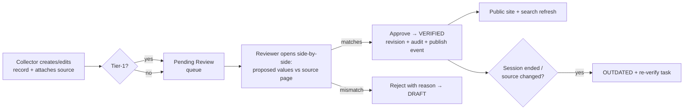

# Sccuni — Data Collection and Verification Strategy

- **Status:** DRAFT v0.1, for founder approval.
- **Last updated:** 19 Nov 2026.
- **Related:** [Official-source evidence](./research/OFFICIAL_SOURCES_RESEARCH.md) · [DATABASE_DESIGN §2.1, §4.9](./DATABASE_DESIGN.md) · [SYSTEM_ARCHITECTURE §5.1](./SYSTEM_ARCHITECTURE.md)

> Data is the product. Code is the easy part. This document defines how Sccuni gets data, proves it, keeps it fresh and corrects it.

---

## 1. Principles

1. **Accuracy over quantity.** A smaller, fully verified dataset beats a large, unreliable one.
2. **Official sources only for critical facts.** Third-party sites (including competitors) may be used to *discover* that something exists, but **never as the source** that verifies it.
3. **Every critical fact is traceable:** source document, page/section locator, academic session, who collected it, who verified it, and when.
4. **Automation proposes, humans approve.** No import, extraction, AI or representative submission can publish Tier-1 data.
5. **Respect access policies.** Follow robots.txt and site terms, never bypass bot protection, rate-limit politely and identify ourselves. Where a site blocks automation, collect manually.
6. **Never store personal data from published merit lists.** Store closing values only.

## 2. Data inventory and criticality tiers

| Tier | Data | Verification rule | Re-verification |
|---|---|---|---|
| **Tier 1 — critical** | Merit formulas, eligibility rules, closing merits, fees, admission deadlines/events, entry-test editions (totals, dates) | Official source + locator required; **four-eyes** (reviewer ≠ collector) | Every admission cycle; immediately on source change |
| **Tier 2 — important** | Programmes and offerings, campuses (incl. HEC approval status), seats, scholarships, accreditation status, application instructions | Official source required; single reviewer allowed | Every cycle or every 6 months |
| **Tier 3 — descriptive** | Descriptions, contact details, addresses, images | Source recommended; single reviewer | Yearly |

## 3. Source hierarchy

A higher rank wins in a conflict. Conflicts at the same rank are escalated to a reviewer and recorded as `CONFLICT` issues.

1. Official prospectus / admission regulations for the session (PDF or official page)
2. Official admission notices and merit-list documents on the institution's or authority's domain
3. Regulator lists (HEC, PMDC, PEC, NCEAC, PBC, PCP, PNMC, NBEAC, IBCC)
4. The institution's official social media posts (when the website lags)
5. Written confirmation from the institution (email from an official domain), archived
6. Verified representative submissions (Release 3) — always reviewed

**Not acceptable as verification sources:** aggregator sites, blogs, forums, news articles (useful as leads only), AI-generated text.

## 4. Official source catalogue (starting point)

From Phase 0 research; full details and verification levels are in [research](./research/OFFICIAL_SOURCES_RESEARCH.md).

| Domain | Use | Automated access observed (19 Nov 2026) |
|---|---|---|
| hec.gov.pk | Recognised universities (filterable list), approved campuses (151, with validity notes), illegal/fake institutions, scholarship programmes, test calendar | ✅ Reachable; no robots.txt (404) |
| ibcc.edu.pk | Grade-to-marks conversion, A* tables per session | ✅ Reachable |
| uhs.edu.pk | Punjab MBBS/BDS prospectus, formula, quotas, worked examples | ✅ Reachable (bare host) |
| pu.edu.pk | PU admission guidelines | ✅ Reachable |
| nu.edu.pk | FAST eligibility/weightages ("Last Updated" dates on pages) | ✅ Reachable |
| giki.edu.pk | GIKI eligibility/weightages | ✅ Reachable |
| uet.edu.pk → admission.uet.edu.pk | UET Lahore admissions, prospectus, merit reports | Main site ✅; admission host not yet tested |
| pmdc.pk | National medical admission regulations, MDCAT notices | ✅ Host reachable; one indexed PDF path 404 |
| nust.edu.pk, ugadmissions.nust.edu.pk | NUST criteria and closing merit positions | ❌ Bot challenge → **manual collection** |
| pec.org.pk | PEC accredited programmes, regulations | ❌ Bot challenge → **manual** |
| comsats.edu.pk | COMSATS prospectus | ❌ Bot challenge → **manual** |

## 5. Collection methods

| # | Method | When | Output | Phase |
|---|---|---|---|---|
| 1 | **Manual entry** in the admin console | Default for Tier-1 data, especially formulas | Draft change request + source link | 7–9 |
| 2 | **Structured spreadsheet templates** (CSV/XLSX) | Bulk data: programmes, offerings, fees, closing merits, events | Import job → validation report → change requests | 9/13 |
| 3 | **PDF document management** | Every prospectus, notice or merit list is uploaded as a Source (private archive + official URL) | Source with hash; page locators referenced by records | 7 |
| 4 | **Assisted PDF extraction** (text/table extraction, later AI-assisted) | Long merit-list tables, fee schedules | Draft rows for human review, with page references | R2 |
| 5 | **Source monitoring** (scheduled HEAD/GET plus hash, robots-aware, low frequency) | Known official pages and PDFs where automation is allowed | "Source changed" issues → re-verification queue | 13 |
| 6 | **Automated web extraction** | Only where robots and terms allow, and the page structure is stable | Drafts only | R2 |
| 7 | **Representative submissions** | After the representative system exists | Change requests, reviewed | R3 |
| 8 | **User error reports** | Always | Data-quality issue → reviewer | 11 |

**Bootstrap plan:** the data team can start **before the admin console exists** by filling the spreadsheet templates (§9), with a source URL and page number on every row. These are imported once the import module ships. The work is not wasted, because the templates mirror the database design.

## 6. Verification workflow

**Reviewer checklist for a merit formula:**
1. The session matches the source document's stated session.
2. Every route (FSc / A-Level / DAE / SAT…) is captured, or explicitly marked "not covered".
3. Weights, Part-I policy, test totals per edition, bonuses/deductions and rounding match the text.
4. **The formula tester reproduces every worked example in the source exactly.**
5. Assignment scope (programme groups, campuses, categories) matches the source; the resolved-rules preview shows no gaps or overlaps.
6. Eligibility conditions are captured, including per-subject minimums, age limits and exemptions. Anything not machine-checkable is captured as INFO_ONLY text.

**Reviewer checklist for closing merits:**
1. Metric type is correct (aggregate vs position vs test score).
2. List number and label, category, shift, campus and session all match.
3. Precision is preserved.
4. No personal data is captured.

## 7. Data quality management

| Check | Rule | Action |
|---|---|---|
| Duplicate detection | Normalised name + city; trigram similarity above threshold; alias matches | "Suspect duplicate" in the import preview and the quality dashboard |
| Invalid values | Obtained > total; weights not summing to the base; dates out of order; negative fees; aggregate outside its scale | Blocked at validation |
| Missing fields | Per-entity completeness rules (e.g. an intake without a verified formula, fee or deadline) | Completeness report per university |
| Freshness | Tier-1 not verified for the current session; `last_verified_at` older than the tier's SLA | OUTDATED labels + review queue |
| Source change | Monitored source hash changed | Re-verification task for every linked record |
| Conflicts | Two official sources disagree (e.g. PEC Regulations vs FAQ on DAE seats) | Escalate; publish only the higher-ranked source; note the conflict internally |
| Coverage | Intakes searched for but missing (zero-result logs) | Prioritised collection backlog |

**Dashboard KPIs:**
- % of Tier-1 fields verified for the current session per university
- open issues by severity
- median review time
- outdated record count
- error reports and their resolution time

## 8. Launch coverage plan (depth first)

1. **Pilot (2 universities):** one with a complex formula (multiple routes, Part-I) and one centrally run medical admission. Measure hours per university to calibrate the plan.
2. **Launch cohort (about 25–40 institutions):** all Tier-1 data for the current session, plus closing merits for the last 2–3 sessions where officially available. Selected by student demand (engineering/computing/medical first; Punjab + ICT, then KP and Sindh). **List to be approved by the founder.**
3. **Expansion:** prioritised by zero-result searches, traffic and founder strategy.

**Per-university "definition of done":**
- profile;
- campuses with HEC status;
- all UG offerings;
- the current session with all events;
- formulas and eligibility for every offering (or explicit "not published");
- current fees;
- the last 2–3 years of closing merits;
- scholarships;
- application guide;
- every Tier-1 record verified by a second person.

## 9. Spreadsheet template specification (v1)

One template per entity. Columns use **codes/slugs**, not free text, for references. Every row carries `source_url`, `source_locator` and `academic_session`.

| Template | Key columns |
|---|---|
| `universities.csv` | slug, name, short_name, institution_kind, sector, chartered_by, website_url, admissions_url, city_slug, is_women_only, source_url, source_locator |
| `campuses.csv` | university_slug, campus_slug, name, city_slug, address, is_main, hec_campus_status, hec_valid_until, source_url, source_locator |
| `programs.csv` | university_slug, program_slug, official_title, canonical_title, discipline_slug, degree_level_code, duration_years, credit_hours, source_url, source_locator |
| `offerings.csv` | program_slug, campus_slug, shift, funding_type, delivery_mode |
| `intakes.csv` | offering key, session_code, status, total_seats, apply_url, source_url, source_locator |
| `admission_events.csv` | session_code, scope (campus/program/group/category), event_type, sequence, starts_at, ends_at, is_tentative, source_url, source_locator |
| `fees.csv` | offering key, academic_year, category_code, billing_basis, fee_item_type, label, amount, currency, frequency, is_refundable, source_url, source_locator |
| `closing_merits.csv` | offering key, session_code, category_code, list_number, list_label, metric, value, scale_max, decimals_published, published_on, source_url, source_locator |
| `scholarships.csv` | provider, name, basis, coverage_type, eligibility_text, application_url, academic_year, opens_on, closes_on, source_url |

Formulas and eligibility rules are **entered in the admin formula editor**, not via CSV, because they need the tester and structured validation.

## 10. Operations model

| Role | Responsibility |
|---|---|
| Data Manager | Plans coverage; collects; creates drafts; runs imports |
| Data Reviewer | Verifies against sources; approves/rejects; resolves conflicts |
| Admin | Users, settings, recommendation policy, escalations |

**Annual data calendar** (refine per institution as observed):
- Track when each institution typically publishes its prospectus, opens applications, holds tests and releases merit lists.
- Schedule collection sprints just before each publication window.
- During admission season, run **daily** checks of deadlines and merit-list releases for the launch cohort.

**Throughput:** unknown until the pilot. Hours per university will be measured, and staffing will be planned from that figure rather than guessed.

## 11. Legal and ethical rules

- **robots.txt and terms of use** are checked before any automated access. Bot protections (e.g. Cloudflare challenges) are never circumvented.
- **Copyright:**
  - link to official PDFs;
  - keep private archived copies only as verification evidence;
  - never redistribute them;
  - write our own neutral descriptions;
  - show university logos only with permission.
- **Personal data:** merit lists often contain names or IDs. We extract **only** closing values; source copies stay private.
- **Corrections and takedowns:** a public contact address plus an internal SLA (48 h in season).
- **Disclaimers:** "Sccuni is not affiliated with any university. Always confirm on the official website before applying."
