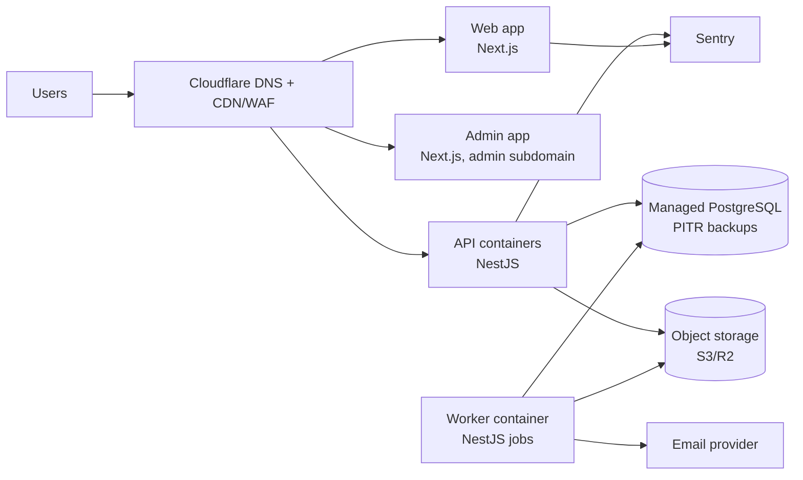

# Sccuni — Deployment Guide

- **Status:** DRAFT v0.1, **planned infrastructure**. Nothing is deployed yet. Vendor choices are recommendations to be confirmed with costs in Phase 6 (staging) and Phase 19 (production).
- **Last updated:** 19 Nov 2026.

## 1. Target topology



| Component | Recommended | Alternatives |
|---|---|---|
| Web + Admin | Vercel (ISR, previews per PR) | Cloudflare Pages / self-hosted Node behind a CDN |
| API + Worker | Managed container platform (e.g. Render, Railway, Fly.io, AWS App Runner/ECS) | Single VPS with Docker Compose (lowest cost, more ops) |
| PostgreSQL | Managed Postgres with PITR (e.g. Neon, AWS RDS, Supabase Postgres) | Self-managed on a VPS (not recommended) |
| Object storage | Cloudflare R2 (no egress fees) | AWS S3 |
| DNS/CDN/WAF | Cloudflare | — |
| Email | Amazon SES or Resend | Postmark |
| Monitoring | Sentry + uptime monitor + platform metrics | Grafana stack later |

**Region:** choose the DB/API region by **measured latency from Pakistani ISPs** (candidates: Middle East, South Asia or Europe regions). Public pages are CDN-cached, so the DB region mainly affects calculations and dashboards. To be measured in Phase 6.

## 2. Environments

| Env | Domains (example) | Deploy trigger | Data |
|---|---|---|---|
| Local | localhost | `pnpm dev` | Docker Compose Postgres; ILLUSTRATIVE fixtures |
| Preview | per-PR URLs | Every PR | Uses the staging API |
| Staging | staging.<domain>, admin.staging.<domain>, api.staging.<domain> | Merge to `main` | Reference + verified institutional data copy; synthetic users |
| Production | <domain>, admin.<domain>, api.<domain> | Manual promotion of a tagged release | Live |

## 3. Local development (planned, Phase 4)

**Prerequisites:**
- Node.js LTS
- pnpm
- Docker

```bash
pnpm install
```

```bash
docker compose -f infra/docker-compose.yml up -d postgres
```

```bash
pnpm db:migrate && pnpm db:seed:dev
```

```bash
pnpm dev
```

`db:seed:dev` loads ILLUSTRATIVE fixtures and refuses to run when `NODE_ENV=production`.

## 4. Configuration and secrets

- Configuration comes from environment variables, validated at boot by a Zod schema. The app fails fast on missing or invalid config.
- `.env.example` (committed) lists **names only**. Real values live only in the hosting platforms' secret stores and GitHub Actions secrets.

| Variable (planned) | Used by |
|---|---|
| `DATABASE_URL` | api, worker |
| `SESSION_SECRET`, `CSRF_SECRET` | api |
| `GOOGLE_OAUTH_CLIENT_ID` / `_SECRET` | api |
| `S3_ENDPOINT`, `S3_BUCKET_PUBLIC`, `S3_BUCKET_PRIVATE`, `S3_ACCESS_KEY_ID`, `S3_SECRET_ACCESS_KEY` | api, worker |
| `EMAIL_PROVIDER_*` | worker |
| `SENTRY_DSN` | all |
| `WEB_REVALIDATE_SECRET`, `WEB_BASE_URL` | worker, web |
| `API_BASE_URL` | web, admin |
| `LLM_PROVIDER`, `LLM_API_KEY` | api (Release 2) |

Never commit secrets. Secret scanning runs in CI.

## 5. CI/CD (GitHub Actions)

1. **On PR:** run the quality gates (TESTING_PLAN §9) → deploy previews → E2E smoke → Lighthouse.
2. **On merge to `main`:**
   - build the API/worker images;
   - run `prisma migrate deploy` on **staging** (release job);
   - deploy the API/worker;
   - deploy the web/admin;
   - run smoke tests.
3. **Release to production** (tag `vX.Y.Z`, manual approval):
   - take a DB snapshot;
   - `migrate deploy`;
   - deploy the API/worker (rolling);
   - deploy the web/admin;
   - run smoke tests;
   - post the release notes from CHANGELOG.
4. **Rollback:**
   - redeploy the previous image/build;
   - migrations are expand/contract, so the previous app version stays compatible;
   - restore from snapshot/PITR only for data incidents.

## 6. Database operations

- **Migrations:** only through CI release jobs; never run manually against production.
- **Backups:**
  - managed PITR (minimum 7 days; 30 days recommended);
  - nightly logical dump to separate storage (different provider or account), retained 30 days;
  - a snapshot before each release.
- **Restore drill:** monthly restore of the latest backup into a scratch DB with an automated integrity check (row counts + a sample query).
- **Access:** least-privilege roles:
  - `app_rw` has no DDL, and only INSERT/SELECT on `audit_logs`;
  - `migrator` holds DDL;
  - `readonly` is for analytics.

## 7. Observability

- Errors: Sentry (web, admin, API, worker), with releases linked to commits.
- Logs: structured JSON (pino) with `requestId`; PII-scrubbed.
- Uptime: external checks on the homepage, a programme page, `/health/ready` and the calculation endpoint.
- **Alerts:**
  - error-rate spikes;
  - p95 latency;
  - job failures (imports, reminders, revalidation);
  - backup failures;
  - certificate expiry.
- Analytics: privacy-respecting product analytics with cookie consent where required; Search Console for SEO.

## 8. Domain and TLS

- DNS on Cloudflare.
- TLS everywhere (HSTS after verification).
- Admin on its own subdomain with stricter CSP and, optionally, Cloudflare Access/IP allow-listing.

## 9. Launch checklist (Phase 19)

**Product and data**
- [ ] Launch cohort Tier-1 data 100% VERIFIED for the current session (second reviewer)
- [ ] Formula golden tests pass for every cohort formula that has an official worked example
- [ ] Disclaimers, terms, privacy policy, corrections/takedown contact live (reviewed by counsel)
- [ ] Under-18 and consent flows reviewed

**Engineering**
- [ ] All CI gates green on the release tag
- [ ] Load test at 10× expected peak passed; CDN cache-hit ratio verified
- [ ] Security: ZAP baseline clean (no high findings); dependency audit clean; staff MFA enforced
- [ ] Backups configured and **restore drill passed**
- [ ] Monitoring and alerts verified by triggering test alerts
- [ ] Sitemaps submitted; robots.txt correct; canonical tags verified; structured data validated
- [ ] Accessibility audit: no critical issues
- [ ] Rollback rehearsed on staging

**Operations**
- [ ] In-season data on-call rota (daily deadline/merit checks)
- [ ] Error-report SLA owner assigned
- [ ] Incident response contacts documented
