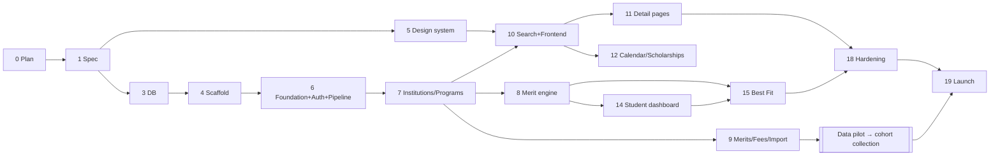

# Sccuni — Project Plan

- **Status:** DRAFT v0.1. Phase 0 complete and awaiting approval.
- **Last updated:** 19 Nov 2026.
- **Related:** [DEVELOPMENT_PROGRESS.md](./DEVELOPMENT_PROGRESS.md) (live status) · [REQUIREMENTS.md](./REQUIREMENTS.md) (scope)

---

## 1. Working method (every phase)

Each phase follows the same loop, and nothing starts without the previous phase's exit criteria being met:

1. Explain what we will build and why.
2. List features and requirement IDs.
3. Recommend the approach.
4. Identify dependencies and risks.
5. Update documentation.
6. **Founder approval** (for scope, cost, architecture or business decisions).
7. Implement in small units.
8. Test (automated where practical).
9. Report: files created/changed, how to run, how to test, what remains.
10. Identify the next phase.

**Definition of Done for any feature:**
- acceptance criteria met;
- automated tests pass in CI;
- typecheck and lint clean;
- docs updated (API, DB, progress, changelog);
- no unverified data exposed publicly;
- reviewed on a mobile viewport.

## 2. Phase sequence and the adjustments made to it

The prescribed order is followed, with **four dependency adjustments**, each explained:

| # | Adjustment | Reason |
|---|---|---|
| A1 | **Verification/publish pipeline, sources and audit log are built in Phase 6** (backend foundation), not in Phase 13 | Every data module in Phases 7–12 must create drafts, attach sources and publish through review. Building it later would mean reworking every module |
| A2 | **Each domain module ships with its own basic admin screens** (Phases 7–9). Phase 13 becomes "advanced admin" (imports UI polish, PDF management, quality dashboards, analytics, CMS) | The data team needs to enter and verify real data **months before launch**. This is the longest lead-time item in the project |
| A3 | **Data collection runs as a parallel track from Phase 3**, using spreadsheet templates; a pilot starts after Phase 9 | Same reason: coverage, not code, decides the launch date |
| A4 | **The MVP launches after Phase 15** (with Phases 18–19 applied to the MVP). Phases 16 (AI Advisor) and 17 (Representatives) follow as Release 2 and Release 3, each with its own test and deploy cycle | Follows "do not build future features before completing the MVP", and targets the 2027 admission season. REP-01 (a simple inquiry form) stays in the MVP |

## 3. Phases

| Phase | Name | Key deliverables | Depends on | Exit criteria |
|---|---|---|---|---|
| **0** | Discovery and planning | PRD, architecture, DB design, data strategy, plans (this set) | — | **Founder approval** |
| **1** | Requirements and feature specification | Acceptance criteria per MVP requirement; permission matrix; page inventory; content/disclaimer copy list | 0 | Signed-off spec |
| **2** | Competitor and market research (completion) | Manual UX benchmark of the blocked sites; founder interviews with 5–10 students/parents (recommended) | 0 | Research notes + insights folded into the spec |
| **3** | Data model and database architecture | Prisma schema + raw SQL migrations; ERD v1; **data templates v1** for the data team | 1 | Migrations apply cleanly in CI; templates issued |
| **4** | Technical architecture | Monorepo scaffold; ADRs accepted; local dev (Docker Compose Postgres); CI (lint/typecheck/test) | 3 | `pnpm dev` runs web+admin+api; CI green |
| **5** | UI/UX and design system | Brand direction, tokens (type, colour, spacing, radius, elevation, motion), core components, key page wireframes (mobile first) | 1, 2 | Approved design system + wireframes for the 14 key pages |
| **6** | Backend foundation and authentication | Auth (email, Google, sessions, MFA for staff), RBAC, **change-request/verification pipeline, sources, assets, audit log (A1)**, error format, rate limiting, OpenAPI, staging deploy | 3, 4 | Auth and authorization test matrix passes; staging live |
| **7** | Universities, campuses, departments, programmes | CRUD + admin screens (A2); aliases; HEC/campus status; accreditations; offerings; intakes; sessions | 6 | Data team can enter and verify institutions end to end |
| **8** | Eligibility and merit engine | `merit-engine` package; formula/rule editor; **formula tester**; resolver + resolved-rules preview; calculation API | 7 | Golden tests reproduce official worked examples exactly; 100% branch coverage |
| **9** | Historical merit and fee management | Merit lists/closings, fee structures, **CSV/XLSX import framework**, duplicate detection | 7 | Import of templates works with validation report; four-eyes enforced. **Data pilot starts (A3)** |
| **10** | University search and frontend | Public app shell, search (FTS + trigram + aliases), filters, facets, sorting, pagination, comparison | 5, 7, 9 | Search test suite passes; Lighthouse budgets met |
| **11** | University and programme detail pages | SSR/ISR pages, structured data, sitemaps, inline calculator, error reporting | 8, 10 | SEO checklist passes; pages show sources and freshness |
| **12** | Admission calendar and scholarships | Calendar views, .ics, scholarship directory, inquiry form (REP-01) | 7, 10 | Calendar/scholarship tests pass |
| **13** | Admin dashboard and data verification (advanced) | Dashboard KPIs, verification queue UX, PDF management, quality dashboards, source monitoring, CMS, analytics | 6–12 | Data team signs off on the workflows |
| **14** | Student dashboard and wishlist | Profile, academic records, saved items/calculations, comparisons, deadline subscriptions, reminders, deletion/export, under-18 flow | 6, 8, 12 | Account tests pass; privacy review |
| **15** | Best Fit Finder | Multi-programme evaluation, recommendation policy, SAFE/TARGET/REACH with explanations, reverse calculator | 8, 9, 14 | Classification tests pass; policy approved by founder |
| **18** | Testing and optimisation (MVP) | Load test, security review, a11y audit, performance tuning, bug bash | 10–15 | Launch checklist items green |
| **19** | Deployment and launch (MVP) | Production infrastructure, backups, monitoring, analytics, legal pages, launch | 18 | **Public beta live** |
| **16** | AI Admission Advisor (R2) | Tool-calling advisor, retrieval over verified text, evaluation set, provider adapter | MVP live | Eval pass-rate threshold; no-fabrication tests |
| **17** | Representative system (R3) | Rep verification, dashboard, inbox, change-request submissions | MVP live | Approval workflow tests |

## 4. Milestones and indicative timeline

**Assumptions:**
- Development is executed with Claude Code, with the founder reviewing each phase within 1–3 days.
- 1–2 data operators start by Phase 3.
- No scope changes.

The dates are **targets, not commitments**. They will be re-estimated after Phase 4 and after the data pilot.

| Milestone | Phases | Target window |
|---|---|---|
| **M0 — Plan approved** | 0–2 | late Nov – early Dec 2026 |
| **M1 — Foundations** | 3–6 | Dec 2026 – mid Jan 2027 |
| **M2 — Data core** (data entry possible; pilot running) | 7–9 | mid Jan – Feb 2027 |
| **M3 — Public discovery** | 10–12 | Mar – mid Apr 2027 |
| **M4 — Admin and students** | 13–14 | mid Apr – mid May 2027 |
| **M5 — Best Fit** | 15 | May 2027 |
| **M6 — MVP public beta** | 18–19 | **target: end of May / early June 2027**, ahead of the main summer UG application window |
| R2 — AI Advisor | 16 | after launch |
| R3 — Representatives | 17 | after R2 |

**Fallback if behind schedule:** ship an "early access" slice (programme pages + merit calculator + admission calendar for the verified cohort) by about April 2027, and add Best Fit and the dashboards after.

## 5. Critical path and dependencies

**The data-collection track (DP) is on the critical path.** If the launch cohort is not verified, the launch slips, regardless of code readiness.

## 6. Top risks to the plan

See REQUIREMENTS §9.3 for the full register. The plan-specific ones:

1. **Data team capacity is not yet defined.** This must be decided at M0.
2. **The review cadence** of each phase drives the timeline.
3. **Design direction and brand assets** are needed by Phase 5.
4. **Hosting and budget approval** is needed by Phase 6 (staging) and Phase 19 (production).

## 7. Decisions required to start Phase 1

These are listed in the Phase 0 report and in REQUIREMENTS §9.2:
- launch cohort;
- data team;
- MVP business model (recommended: none);
- Urdu timing;
- brand/domain;
- monthly budget;
- approval of the stack (SYSTEM_ARCHITECTURE §2).
