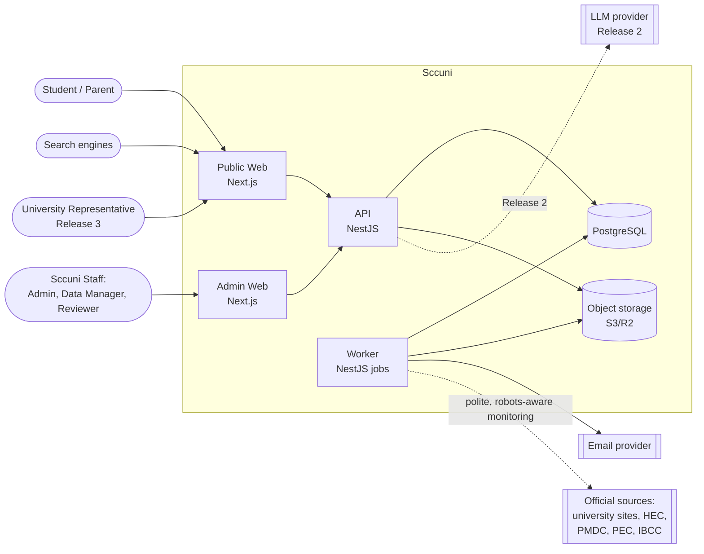
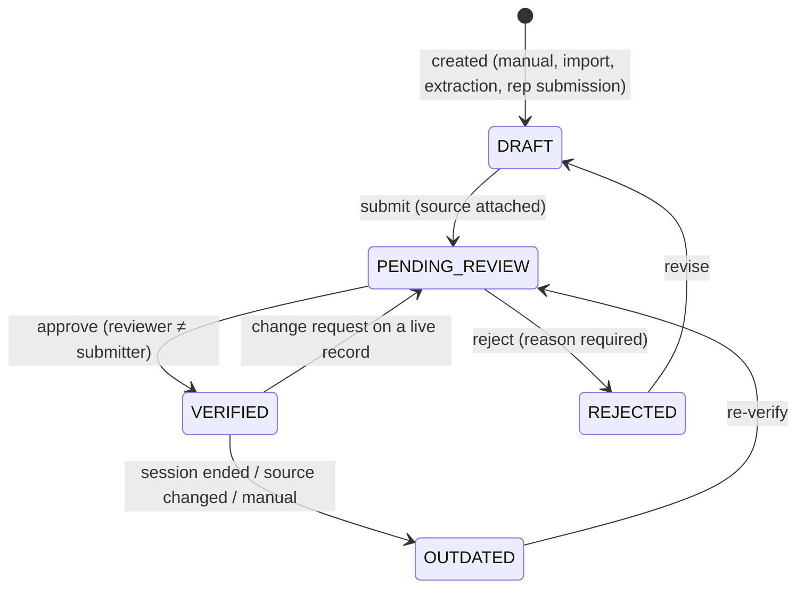

# Sccuni — System Architecture

- **Status:** DRAFT v0.1. Proposed in Phase 0, pending founder approval.
- **Last updated:** 20 Nov 2026 (§4.0 added: where the frontend lives today).
- **Owners:** Architecture (Claude Code) + Founder.
- **Related:** [REQUIREMENTS.md](./REQUIREMENTS.md) · [DATABASE_DESIGN.md](./DATABASE_DESIGN.md) · [API_DOCUMENTATION.md](./API_DOCUMENTATION.md)

---

## 1. Architectural drivers

These are the forces that shape every decision below, in priority order.

1. **Data correctness and traceability.** Every critical fact (formula, eligibility rule, closing merit, fee, deadline) is versioned, sourced and verified before it is public.
2. **Configurable, explainable merit engine.** No university-specific code. Formulas are data, every result shows its breakdown, and history is immutable.
3. **SEO plus mobile performance.** Students arrive from Google on mid-range Android phones over mobile data. Public pages must be server-rendered, cacheable and light.
4. **Admin productivity.** A small data team must maintain hundreds of universities without developer involvement.
5. **Small-team maintainability and low cost.** Few moving parts, one language (TypeScript), managed services.
6. **Evolvability.** The AI advisor, representative portal, mobile app and monetisation must plug in later without rewrites.

## 2. Recommended technology stack

| Layer | Choice | Why | Alternatives considered |
|---|---|---|---|
| Language | **TypeScript** everywhere | One language for web, API, engine and tooling. The merit engine is shared by browser and server | — |
| Monorepo | **pnpm workspaces + Turborepo** | Shared packages (engine, contracts, UI); cached builds; simple | Nx (heavier), separate repos (drift) |
| Public web | **Next.js (App Router) + React + Tailwind CSS** | SSR/SSG/ISR for SEO, mature ecosystem, matches the founder's preference | Astro (great for content, weaker for app-like tools); Remix/React Router (smaller ecosystem for ISR/CDN) |
| Admin web | **Separate Next.js app** (`apps/admin`) | Different security posture (no indexing, stricter CSP, own subdomain, possible IP allow-list). Keeps admin code out of the public app | Admin inside the public app (simpler, weaker isolation); Django admin (fast CRUD but a second language, and our verification and formula workflows are custom anyway) |
| UI primitives | **Radix UI primitives + own design system** (`packages/ui`) | Accessible headless primitives; Sccuni owns the look (no generic template) | MUI/Chakra (opinionated look, heavier) |
| API | **NestJS (REST, OpenAPI)** | Modules, DI, guards and interceptors suit a large domain with RBAC, jobs and multiple clients (web, admin, future mobile, AI tools) | Next.js route handlers only (fewer deployables, but business logic gets tangled with UI); Fastify/Express bare (less structure) |
| Validation and contracts | **Zod** schemas in `packages/contracts`, shared by forms and API (via `nestjs-zod`), generating OpenAPI | One source of truth for validation; typed client | class-validator (Nest default, but cannot be shared with the frontend) |
| Database | **PostgreSQL 16+** | Relational integrity, JSONB for snapshots, full-text search, `pg_trgm`, `unaccent`, and later `pgvector`. One DB covers search and AI retrieval at MVP | MySQL (weaker FTS/JSONB), MongoDB (poor fit for relational, versioned data) |
| ORM / migrations | **Prisma** (+ raw SQL migrations for triggers, generated columns, extensions; TypedSQL for search queries) | Excellent DX and migrations; founder preference | Drizzle (closer to SQL, also good); TypeORM (weaker typing) |
| Background jobs | **pg-boss** (Postgres-backed queue), behind a `JobQueue` interface | No extra infrastructure at MVP; jobs are backed up with the DB; scheduled jobs supported | BullMQ + Redis (excellent, but adds a stateful service; adopt if throughput demands it) |
| Cache | Next.js ISR + CDN + HTTP caching (ETag). **No Redis at MVP** | Public data changes rarely; tag-based revalidation on publish | Redis (add when we run more than one API instance needing shared rate limits or caching) |
| Search | **PostgreSQL FTS + pg_trgm**, over a denormalised `offering_search` table, behind a `SearchService` interface | Dataset is small (hundreds of universities, tens of thousands of offerings); faceting in SQL is fast enough | Meilisearch/Typesense (adopt when p95 search exceeds 300 ms or instant-search UX needs it) |
| Precise arithmetic | **decimal.js** in the merit engine | Avoids floating-point drift; published merits use 4–5 decimals and official examples rely on component-level rounding | Native JS numbers (unsafe at this precision) |
| Object storage | **S3-compatible** (Cloudflare R2 recommended: no egress fees) | Prospectus/merit PDFs (private evidence), logos and images (public via CDN) | AWS S3 (fine; egress costs) |
| Auth | **API-owned auth:** email+password (argon2id), Google OAuth, opaque DB-backed sessions in httpOnly cookies, TOTP MFA for staff | Full control, no per-MAU fees, revocable sessions, data stays in our DB | Clerk/Auth0 (fast, but per-MAU cost and data residency); Auth.js (frontend-centric; awkward with a separate API) |
| Email | Transactional provider (Amazon SES or Resend; decide in Phase 6) | Verification, password reset, deadline reminders | SMS/WhatsApp (later, cost-gated) |
| Observability | **Sentry** (errors, web+api), **pino** JSON logs with request IDs, uptime monitor, health endpoints | Cheap, effective | Full OpenTelemetry stack (later) |
| AI (Release 2) | Provider-agnostic `LlmProvider` interface; **tool-calling over Sccuni's own API** + `pgvector` retrieval for text | Facts come from verified DB records and math from the merit engine, never from the model | Pure vector RAG (weak for numeric facts) |
| CI/CD | **GitHub Actions** | Lint, typecheck, tests, build, migrations, deploy | — |
| Hosting | Proposed: Vercel (web, admin) + container host for API/worker + managed Postgres + R2 + Cloudflare DNS. **Final choice in Phase 19, with costs** | Managed services minimise ops for a small team | Single VPS with Docker Compose (cheapest, more ops) — a valid option if budget is tight |

**Runtime:** Node.js LTS. The container currently has Node 22; adopt the Active LTS at project initialisation.

### 2.1 Technologies deliberately NOT introduced at MVP

Each of these has a defined trigger for adding it later.

| Technology | Add when |
|---|---|
| Redis | More than one API instance needs shared rate limiting or caching, or job throughput outgrows pg-boss |
| Meilisearch / Typesense | Search p95 exceeds 300 ms at production load, or typo-tolerant instant search is prioritised |
| Separate vector DB | `pgvector` latency or recall is insufficient (unlikely at our scale) |
| Kubernetes | Never at our scale unless requirements change materially |
| GraphQL | No current need; REST + OpenAPI fits caching, SEO fetches and mobile clients |
| Microservices | Not needed. A modular monolith with clear module boundaries gives the same separation with far less ops |

## 3. System context



## 4. Container and code organisation

```
sccuni/
├─ apps/
│  ├─ web/          # Public site + student dashboard (Next.js, SSR/ISR)
│  ├─ admin/        # Staff console (Next.js, client-heavy, noindex)
│  └─ api/          # NestJS: HTTP entrypoint (main.ts) + worker entrypoint (worker.ts)
├─ packages/
│  ├─ merit-engine/ # Pure TS, zero I/O: eligibility, aggregate, required-score, classification
│  ├─ contracts/    # Zod schemas + inferred types for API DTOs, shared by web/admin/api
│  ├─ db/           # Prisma schema, migrations (incl. raw SQL), dev fixtures (ILLUSTRATIVE only)
│  ├─ ui/           # Sccuni design system (tokens, components) on Radix primitives
│  └─ config/       # ESLint, TSConfig, Tailwind preset, Prettier
├─ docs/            # This documentation set
├─ infra/           # docker-compose for local dev, Dockerfiles, CI workflows
└─ .github/workflows/
```

### 4.0 Current state (20 Nov 2026)

The first code is the web frontend, built at the founder's request. It lives in a **top-level `frontend/` folder** (a standalone Next.js app), not yet in `apps/web`:

| Item | Version / choice |
|---|---|
| Framework | Next.js 16.4.6 (App Router, Turbopack, Cache Components / partial prerendering) |
| UI | React 19.3, TypeScript 5 (strict), Tailwind CSS 4.3 |
| Merit maths | decimal.js 10.6 (exact decimal arithmetic) |
| Icons and fonts | lucide-react; self-hosted Inter and Plus Jakarta Sans |
| Tests | Vitest 4 (merit engine, including the UHS golden case) |

Mapping to the planned layout:

| Today in `frontend/` | Planned home |
|---|---|
| `src/app/(site)`, `(account)` | `apps/web` |
| `src/app/admin` | `apps/admin` (ADR-011) |
| `src/lib/merit/engine.ts` | `packages/merit-engine` |
| `src/components/ui`, `globals.css` tokens | `packages/ui`, `packages/config` |
| `src/lib/data` (sample data) | API client generated from `packages/contracts` |

`frontend/` will become `apps/web` when the monorepo and API are created. Until then all data is fictional sample data behind one data-access module (`src/lib/data/index.ts`), so swapping in the API changes only that module.

**Why one `api` app with two entrypoints?** The worker shares all domain services and repositories with the HTTP API. Two processes from one codebase avoid duplicated logic, and the worker scales independently.

### 4.1 API module map (modular monolith)

Modules talk to each other only through exported services, never by reaching into another module's tables.

| Module | Responsibility |
|---|---|
| `auth` | Registration, login, sessions, OAuth, email verification, password reset, MFA |
| `users` / `rbac` | Users, roles, permissions, representative scoping |
| `reference` | Regions, cities, degree levels, disciplines, qualification types, subjects, boards |
| `institutions` | Universities, campuses, departments, aliases, HEC status, accreditations |
| `programs` | Programmes, offerings (programme × campus × shift), intakes (offering × session) |
| `admissions` | Admission sessions, events/deadlines, seat allocations, application info |
| `entry-tests` | Tests, editions (year/series, totals, dates) |
| `merit` | Formula schemes, versions, routes, components; eligibility rule sets; resolver; calculation service (wraps `merit-engine`) |
| `merit-history` | Merit lists and closing values |
| `fees` | Fee structures and items |
| `scholarships` | Scholarships, cycles, applicability |
| `search` | Search index maintenance, query service, facets |
| `recommendations` | Best Fit Finder, recommendation policies |
| `students` | Profiles, academic records, test scores, preferences, saved items, comparisons, saved calculations |
| `notifications` | In-app notifications, email reminders, subscriptions |
| `sources` | Sources, documents, source monitors |
| `verification` | Change requests, review workflow, publish pipeline, revisions |
| `imports` | CSV/XLSX import jobs, validation, duplicate detection |
| `extraction` | PDF text extraction, assisted extraction (always produces drafts) |
| `content` | CMS pages, guides, FAQs |
| `inquiries` | Contact/inquiry forms (MVP). Representative inbox in Release 3 |
| `audit` | Append-only audit log |
| `advisor` | AI Admission Advisor (Release 2) |

## 5. Key architectural mechanisms

### 5.1 Verification and publish pipeline

The central mechanism protecting principle #1 ("accuracy over quantity").



Rules:

1. **The public API serves only `VERIFIED` records.** `OUTDATED` records are served only where explicitly allowed (e.g. historical merits) and always labelled. This is enforced in the repository layer (default scopes) and by partial indexes, not left to each endpoint.
2. **Edits to a live record never change it in place.** They create a `ChangeRequest` holding the proposed values and a diff. The live record changes only when the request is approved, inside one transaction that also writes a `RecordRevision` snapshot and an `AuditLog` entry.
3. **Four-eyes rule** for Tier-1 data (formulas, eligibility, closing merits, fees, deadlines): the approver must differ from the submitter. Configurable per tier.
4. **A source is required to verify.** A Tier-1 record cannot become `VERIFIED` without `source_id` (and a locator such as a page number). Enforced with DB `CHECK` constraints plus service validation.
5. **Automation creates drafts only.** Imports, PDF extraction, AI-assisted extraction and representative submissions can only create `DRAFT`/`PENDING_REVIEW` change requests. No automated path can set `VERIFIED`.
6. **Publishing triggers cache revalidation.** On approval the API emits a domain event. The worker refreshes the search index rows and calls the web app's revalidation endpoint for the affected cache tags (e.g. `university:{id}`, `offering:{id}`).

### 5.2 Merit engine (`packages/merit-engine`)

A pure, deterministic TypeScript library with no I/O and no knowledge of any specific university.

**Inputs**
- `StudentAcademicSnapshot`: qualification route, SSC/HSSC Part-I/HSSC full/equivalence/DAE marks with totals, test attempts (test, edition, obtained, total or percentile, date), flags such as Hafiz-e-Quran (with claimed marks where committee-graded), domicile, gender, date of birth, passing years.
- `FormulaVersionDefinition`: a resolved, immutable formula version.
- `EligibilityRuleSet`: a resolved, immutable rule set.

**Public API (planned)**

```ts
evaluateEligibility(ruleSet, student)        -> EligibilityResult      // ELIGIBLE | CONDITIONAL | NOT_ELIGIBLE | UNKNOWN, per-condition reasons
selectRoute(formula, student)                -> RouteSelection          // which route applies, or why none does
calculateAggregate(formula, student, opts)   -> AggregateResult         // aggregate + component breakdown + adjustments + warnings
requiredComponentScore(formula, student, target, componentKey) -> RequiredScoreResult // "marks needed in test to reach X"
classify(policy, comparisons)                -> Classification          // SAFE | TARGET | REACH | NO_DATA, with reasons
ENGINE_VERSION                               // semver, stored with every saved calculation
```

**Formula model.** A formula is data, validated by a Zod schema. The structure is shown below with **ILLUSTRATIVE** placeholder values; they are not real data.

```jsonc
{
  "schemaVersion": 1,
  "routes": [{
    "key": "intermediate",                    // e.g. intermediate | a_level | dae | sat
    "appliesTo": { "qualificationTypes": ["HSSC_PRE_ENG", "HSSC_ICS"], "acceptedTests": ["TEST_X"] },
    "components": [
      { "key": "ssc",  "source": "SSC",  "weight": "W1" },
      { "key": "hssc", "source": "HSSC", "weight": "W2",
        "sourcePolicy": "FULL_ELSE_PART1" },   // ALWAYS_PART1 | FULL_ONLY | FULL_ELSE_PART1
      { "key": "test", "source": "ENTRY_TEST", "weight": "W3",
        "testInput": "MARKS",                  // MARKS | PERCENT | PERCENTILE | CONVERSION_TABLE
        "attemptPolicy": "BEST",               // BEST | LATEST
        "validity": { "maxAgeYears": 1 },
        "minPercentToQualify": "T1" }
    ],
    "adjustments": [
      { "type": "BONUS", "when": "HAFIZ_E_QURAN", "mode": "FIXED|RANGE", "value": "B1", "appliesTo": "HSSC_OBTAINED" },
      { "type": "DEDUCTION", "when": "LATE_SESSION", "perUnit": "D1", "maxUnits": "D2", "appliesTo": "ACADEMIC_PERCENT" }
    ]
  }],
  "computation": {
    "base": 100,                                       // or e.g. a marks base such as 1200
    "componentRounding": { "decimals": 2, "mode": "HALF_UP" },  // optional
    "finalRounding":     { "decimals": 4, "mode": "HALF_UP" }
  }
}
```

**Every variation found in the official-source research has a home in this model** (see [research §4](./research/OFFICIAL_SOURCES_RESEARCH.md#4-structural-variations-the-engine-and-data-model-must-support)):

| Variation | Where it lives |
|---|---|
| Different component sets | `components` |
| Formula depends on route | `routes[].appliesTo` |
| Part-I policies | `sourcePolicy` |
| Rounding on a marks base | `computation` |
| Percentile and best-attempt test inputs | `testInput` / `attemptPolicy` |
| Validity windows | `validity` |
| Fixed or range bonuses and capped deductions | `adjustments` |
| Mid-cycle threshold changes | versions with effective dates (§5.3) |

**Guarantees**
- **Decimal arithmetic** with explicit rounding at the stages the formula defines.
- **Golden tests** reproduce the official worked examples in prospectuses exactly. Example: the UHS 2025-26 Annexure-IV result of 93.6033% depends on 2-decimal component rounding.
- **Three-valued outcomes.** Missing inputs produce `UNKNOWN` with an explicit "provide X" message, never a silent zero.
- **Committee-graded bonuses** (range) produce a min–max aggregate band, never a single invented number.
- **Snapshotting.** Saved calculations store the input snapshot, the full formula version definition, the result and `ENGINE_VERSION`. A later formula or engine change can never alter a saved result.
- **Shared execution.** The engine runs in the browser for instant feedback. The server recomputes authoritatively for anything saved or used in recommendations.

### 5.3 Rule resolution (which formula and rules apply to an intake?)

Universities apply one formula broadly with exceptions (per programme group, campus, category). Rather than copy a formula onto every programme, **formula versions and eligibility rule sets are *assigned* with a scope**:

```
scope = { university, admission_session, [campus], [program | program_group | discipline], [shift], [admission_category] }
```

The resolver picks the **most specific** matching assignment, using an explicit specificity score: programme+campus+category beats programme, which beats programme group, which beats university-wide.

- **Ambiguity is a data error.** Two matches at equal specificity are rejected at review time.
- The admin console has a **"resolved rules preview"** showing, for every intake in a session, which formula and rule set will be used, and flags intakes that resolve to none ("formula unavailable" is shown to students honestly).
- Versions also carry `effective_from`/`effective_to` *within* a session, to model mid-cycle changes such as a regulator's one-time threshold relaxation.

### 5.4 Historical comparison and SAFE / TARGET / REACH

Comparing a student's aggregate with a past closing merit is only meaningful if both were computed the same way. Rules:

1. Compare like with like. For each historical year *y* with a verified closing **aggregate** (same intake, category, shift and chosen list, e.g. "final list"), compute the student's aggregate **using the formula version effective in year *y*** when it is verified. Otherwise, use the current formula only if the versions are flagged "structurally equivalent" by a reviewer. Otherwise, mark the comparison "not comparable".
2. **Position/rank closing merits are never compared with aggregates.** They are shown as information only, e.g. "last year's closing position: 1,234".
3. Classification thresholds live in a versioned **`RecommendationPolicy`** (admin-configurable, never hard-coded): for example, SAFE if the margin is at least +s in all of the last N comparable years; TARGET if it falls in [−t, +s); REACH if it falls in [−r, −t); otherwise not shown. **Initial values to be agreed with the founder.**
4. **Eligibility gates everything.** `NOT_ELIGIBLE` is never recommended. `UNKNOWN` prompts for the missing data. `CONDITIONAL` (e.g. a deficiency course is required) is shown with the condition.
5. Every recommendation includes a plain-language "why", the years compared, the sources, and the standing disclaimer that past merit does not guarantee admission.
6. **Promotions are architecturally isolated.** The recommendations module has no read access to any sponsorship or promotion data, so paid placement cannot affect organic results (principle #12).

### 5.5 Rendering and caching strategy (web)

| Page type | Strategy | Indexable |
|---|---|---|
| Home, guides, university, programme, city, discipline landing pages | SSG/ISR + on-demand revalidation by cache tag on publish | Yes (with quality thresholds; thin pages `noindex`) |
| Search results | SSR from query params; canonical to curated combinations | Only curated combos (e.g. discipline × city) |
| Merit calculator, Best Fit Finder | Server shell + client islands; engine runs client-side | Calculator landing pages yes; results no |
| Student dashboard, auth pages | Client-rendered behind auth | No |
| Admin app | Client-rendered SPA-style | No (`noindex` + auth + separate subdomain) |

**Performance budgets** (enforced in CI with Lighthouse CI on a throttled mobile profile):
- LCP under 2.5 s;
- CLS under 0.1;
- INP under 200 ms;
- initial JS on public content pages ideally under 150 KB gzipped.

### 5.6 Search

- A denormalised **`offering_search`** table: one row per published intake or offering, holding university, campus city, region, sector, discipline, level, shift, fee estimate, admission status, accepted tests, and a weighted `tsvector`.
- It is maintained by the worker on publish events (and a nightly full rebuild as a safety net).
- **Query:** FTS (`websearch_to_tsquery`) + `pg_trgm` similarity for typos and short names ("uet lhr", "comsat") + a **`university_aliases`** table (abbreviations; Urdu names later).
- **Facets:** `GROUP BY` counts on the filtered set.
- **Zero-result queries are logged** (anonymised) to drive data-collection priorities.

### 5.7 Background jobs (worker)

| Job | Trigger |
|---|---|
| Import processing (parse, validate, detect duplicates, create change requests) | On upload |
| PDF text extraction / assisted extraction (drafts only) | On document upload |
| Search index refresh, cache revalidation | On publish event |
| Source monitoring (hash comparison, flags records for re-verification) | Scheduled, polite, robots-aware |
| Freshness sweep (marks records `OUTDATED` when a session ends or an effective date passes) | Daily |
| Deadline reminders (email/in-app) | Daily |
| Sitemap generation | On publish / daily |
| Knowledge index rebuild for the AI advisor | Release 2, on publish |
| Backup verification (restore test) | Monthly |

### 5.8 AI Admission Advisor (Release 2 — architecture reserved now)

- **Tool-calling over Sccuni's verified API:** `search_programs`, `get_offering`, `get_formula`, `get_closing_merits`, `calculate_aggregate` (the merit engine), `get_deadlines`, `get_fees`, `get_scholarships`.
- **The model never does the maths and never states a fact without a tool result.**
- `pgvector` retrieval for unstructured verified text (admission instructions, scholarship descriptions, guides).
- **Answer contract:** each answer lists sources (record + official URL + last verified date), and separates "verified facts" from "not available in Sccuni". When nothing is found, the advisor says so instead of guessing.
- `LlmProvider` interface (`chat`, `stream`, `embed`) with provider adapters chosen by configuration. The provider is selected in Phase 16 by quality and cost evaluation.
- Search and calculators never depend on the AI being available.

## 6. Security architecture (summary; details in Phase 6 / Phase 18)

- **Auth:**
  - argon2id password hashing;
  - opaque random session tokens (stored hashed) in `httpOnly; Secure; SameSite=Lax` cookies on the parent domain;
  - session rotation on login and privilege change;
  - **TOTP MFA required for all staff roles**.
- **CSRF:** SameSite cookies plus Origin/Referer validation plus a CSRF token on state-changing requests from browsers.
- **RBAC:** roles map to permissions in code (roles are fixed). Representatives are additionally scoped to their university, checked in guards *and* in queries.
- **Input:** Zod validation at the API boundary; Prisma parameterised queries; lint rule banning `$queryRawUnsafe`; output encoding by React; strict CSP on both apps.
- **Rate limiting:** per IP and per account on auth, search, calculation and inquiry endpoints (`@nestjs/throttler`; Redis store if horizontally scaled).
- **Uploads:**
  - presigned URLs to a private bucket;
  - MIME sniffing by magic bytes;
  - size limits;
  - PDFs never served from our origin unsanitised;
  - malware scanning for representative uploads (Release 3).
- **Secrets:** only in the hosting platform's secret store; `.env.example` documents names only; secret scanning in CI.
- **Audit:** append-only `audit_logs` (the app DB role has no UPDATE/DELETE on it) covering all staff mutations, logins, role changes and exports.
- **Privacy:**
  - data minimisation;
  - explicit consent before sharing a student's details with a university (inquiries);
  - account deletion and export;
  - age-aware handling for under-18 users (see REQUIREMENTS NFR-PRIV).

## 7. Environments

| Env | Purpose | Data |
|---|---|---|
| Local | Docker Compose Postgres, `pnpm dev` | ILLUSTRATIVE fixtures only |
| Preview | Per-PR web/admin previews against the staging API | Staging data |
| Staging | Full stack, production-like | Copy of reference data plus test accounts; never real student data |
| Production | Live | Real |

Details are in [DEPLOYMENT_GUIDE.md](./DEPLOYMENT_GUIDE.md).

## 8. Architecture decision log (ADRs)

| # | Decision | Status |
|---|---|---|
| ADR-001 | TypeScript monorepo (pnpm + Turborepo) | Proposed |
| ADR-002 | Next.js for public and admin apps; NestJS modular-monolith API | Proposed |
| ADR-003 | PostgreSQL + Prisma; raw SQL migrations for triggers, FTS, extensions | Proposed |
| ADR-004 | Merit formulas as versioned data interpreted by a pure, shared engine with decimal arithmetic | Proposed |
| ADR-005 | Scoped assignment + specificity resolver for formulas and eligibility rules | Proposed |
| ADR-006 | Change-request based publishing; public API serves verified data only | Proposed |
| ADR-007 | Postgres FTS + pg_trgm for search at MVP; Meilisearch deferred behind an interface | Proposed |
| ADR-008 | pg-boss for jobs at MVP; Redis deferred | Proposed |
| ADR-009 | API-owned, cookie-session auth; MFA for staff | Proposed |
| ADR-010 | AI advisor via tool-calling over the verified API; provider-agnostic | Proposed (Release 2) |
| ADR-011 | Separate admin app and subdomain | Proposed |

Each ADR becomes "Accepted" when the founder approves this plan, and is then recorded in `docs/adr/` with full context.
